<p align="center">
  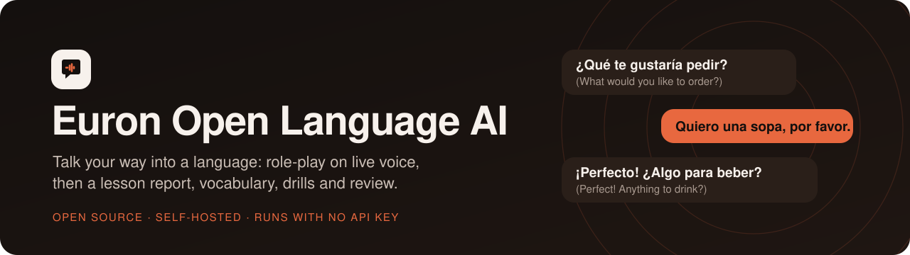
</p>

<p align="center">
  
  <a href="LICENSE"></a>
  
  
  
  
  
  
  
  
  
  
</p>

<p align="center">
  <a href="https://github.com/euron-sde-team/euron-open-language-ai/stargazers"></a>
  <a href="https://github.com/euron-sde-team/euron-open-language-ai/fork"></a>
  <a href="https://github.com/euron-sde-team/euron-open-language-ai/watchers"></a>
  <br>
  <a href="https://github.com/euron-sde-team/euron-open-language-ai/issues"></a>
  <a href="https://github.com/euron-sde-team/euron-open-language-ai/pulls"></a>
  <a href="https://github.com/euron-sde-team/euron-open-language-ai/commits/main"></a>
  
  <br>
  <a href="#built-by-the-team-behind-euron"></a>
</p>

<p align="center">
  <b><a href="#-quickstart">Quickstart</a></b> ·
  <b><a href="#️-architecture">Architecture</a></b> ·
  <b><a href="#-explore-the-repository">Explore the repo</a></b> ·
  <b><a href="docs/api/rest-contract.md">API reference</a></b> ·
  <b><a href="docs/api/realtime.md">Realtime</a></b> ·
  <b><a href="#️-deploy-to-aws">Deploy</a></b> ·
  <b><a href="docs/architecture/security.md">Security</a></b> ·
  <b><a href="#-documentation">Docs</a></b>
</p>

**Euron Open Language AI** is an open-source, self-hosted **AI language tutor you talk to**. Pick the
language you want to learn and the one you speak, say how good you are and what you are learning it
for, and choose a situation: ordering food, hotel check-in, a job interview, a client meeting. Then
a tutor plays the other person **out loud, in real time**, over **OpenAI Realtime** or **Gemini
Live**: it speaks the target language, gives the meaning in your own language in brackets, corrects
only real mistakes, and asks one follow-up per turn. When you hang up, you get a **lesson report**:
a summary, your corrections, key vocabulary, five short drills and four scores. Words you save go
into a **spaced-repetition deck** you review in a few minutes a day, and a progress page shows your
streak, minutes and score trend. It is MIT-licensed and part of the open-source initiative of
**ENGAGESPHERE TECHNOLOGY PRIVATE LIMITED**.

Admins run the deployment from an `/admin` control plane: users, monthly allowances of practice
sessions and voice minutes, the scenario library, text and voice models with prices for a cost
estimate, practice metadata (never transcripts), settings and the audit log. There are no payments:
you decide what each person gets.

The parts that usually go wrong in voice AI apps are designed in, not bolted on:

- **The server writes the tutor, not the browser.** Instructions are built on the server from the
  scenario and the learner's profile and locked into a short-lived provider credential. The browser
  never sees a provider key and never sends instructions, so a learner cannot turn the tutor into a
  free general-purpose voice assistant.
- **The report comes from the server.** The browser reports what was said; a background job writes
  the lesson with a text model, or with the built-in offline engine when none is configured. The API
  rejects any score a client tries to send.
- **Voice time is measured and capped on the server.** Each session has a hard length from the
  monthly allowance, time is booked from the server's clock, abandoned sessions are swept, and OpenAI
  calls are hung up when their time is over.
- **Ownership is a 404.** Another person's session, transcript, deck and reports do not exist for you,
  and admins see metadata only.

Everything runs on a laptop with no API key at all: a deterministic engine writes the lesson report,
and a stub tutor speaks scripted Spanish, French, German, Hindi or English lines with the browser's
own voice while you type or dictate your replies. An AWS emulator stands in for SES and Secrets
Manager, and it deploys to AWS with the same Terraform.

<p align="center">
  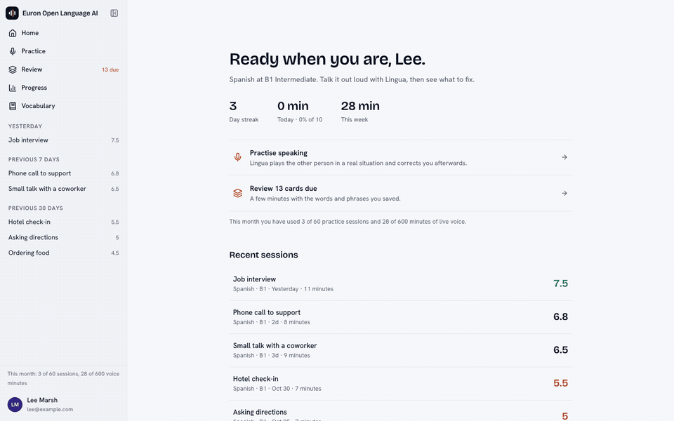
</p>

> [!NOTE]
> Everything in the tour and the screenshots ran for real on a laptop: the API's real provider
> adapters talking to the local stand-ins over the same wire formats the real providers use. The
> stub tutor stands in for the realtime voice, which needs an OpenAI or Gemini key; add one and the
> same room holds the conversation out loud. The offline lesson engine is a stand-in, not a grader:
> it measures simple things about what you said. `make up && make demo` reproduces it.

<h3 align="center">Built by the team behind Euron</h3>

<p align="center">
  <sub>Euron Open Language AI is part of the open-source initiative of ENGAGESPHERE TECHNOLOGY PRIVATE LIMITED, made by the people who build<br>the platforms below. If you like how this repository is built, come and see what we build with it.</sub>
</p>

<p align="center">
  <a href="https://euron.one"><picture><source media="(prefers-color-scheme: dark)" srcset="docs/assets/brand/euron-dark.svg"></picture></a>
  <a href="https://euronsystems.com"><picture><source media="(prefers-color-scheme: dark)" srcset="docs/assets/brand/euron-systems-dark.svg"></picture></a>
  <a href="https://alphaeuron.com"><picture><source media="(prefers-color-scheme: dark)" srcset="docs/assets/brand/alpha-euron-dark.svg"></picture></a>
</p>

<p align="center">
  <a href="https://www.instagram.com/euron_official"></a>
  <a href="https://www.linkedin.com/company/euronone/posts/"></a>
  <a href="https://x.com/euron712"></a>
  <a href="https://www.youtube.com/@Euron-official"></a>
  <a href="https://whatsapp.com/channel/0029VaeeJwq9RZAfPW9P2l07"></a>
</p>

---

## 📚 Table of contents

- [Why Euron Open Language AI](#-why-euron-open-language-ai)
- [At a glance](#-at-a-glance)
- [Screenshots](#️-screenshots)
- [Features](#-features)
- [Architecture](#️-architecture)
  - [One session, from credential to lesson report](#one-session-from-credential-to-lesson-report)
  - [How each provider keeps the tutor on script](#how-each-provider-keeps-the-tutor-on-script)
  - [Data model](#data-model)
- [Tech stack](#-tech-stack)
- [Prerequisites](#-prerequisites)
- [Quickstart](#-quickstart)
- [Use real voice and text models](#-use-real-voice-and-text-models)
- [Explore the repository](#-explore-the-repository)
- [API](#-api)
- [Configuration](#️-configuration)
- [Deploy to AWS](#️-deploy-to-aws)
- [Security model](#-security-model)
- [Testing](#-testing)
- [Documentation](#-documentation)
- [Roadmap](#️-roadmap)
- [FAQ](#-faq)
- [Contributing, security and license](#-contributing-security-and-license)

---

## 💡 Why Euron Open Language AI

Most language apps teach you to recognise words. Speaking out loud to a patient person who corrects
you is what builds fluency, and it is the part nobody has time or money for. A realtime voice model
can be that person, but a demo is not a product: someone has to keep it on topic, cap the minutes,
keep each learner's practice private, turn a conversation into something worth reviewing, and run it
on a budget. This repository is that product, built to be read and changed:

- **A whole learning loop**, not a chat box: onboarding, scenarios by level and goal, a voice room,
  a report that finds your mistakes, a deck that makes you remember them, and a page that shows you
  are improving.
- **Honest offline mode.** It runs and teaches with no key. The offline lesson engine and the stub
  tutor are deterministic and tested, and the docs say plainly what they are and are not.
- **Pluggable models.** OpenAI Realtime and Gemini Live for voice; OpenAI, Anthropic, Gemini or any
  OpenAI-compatible endpoint (OpenRouter, Groq, a local Ollama) for the lesson report.
- **Operable.** Monthly quotas with admin overrides, a cost estimate, an audit log, retention,
  Terraform for AWS and a local AWS emulator, so what you test is what you deploy.

## 📊 At a glance

| | |
|---|---|
| Languages | 21 offered, English and Spanish through Hindi, Tamil, Japanese and Arabic; the tutor and its voice are configurable per language ([add one](docs/guides/add-a-language.md)) |
| Levels | CEFR A1 to C2, goals Travel, Interview, Business, Daily and Academic |
| Scenarios | 12 role-plays out of the box, edited in `/admin` ([write one](docs/guides/write-a-scenario.md)) |
| Voice | OpenAI Realtime over WebRTC, Gemini Live over WebSocket, a stub voice with no key |
| Lesson report | Summary, corrections, vocabulary, 5 drills, fluency, accuracy, vocabulary range, confidence |
| Review | SM-2 style spaced repetition (again, hard, good, easy) |
| Accounts | Email and password, TOTP two-factor, sessions, password reset, data export and deletion |
| Admin | Users, quotas, scenarios, models, practice metadata, settings, audit log |
| API | 81 operations, OpenAPI 3.1 generated from the routes |
| Tests | 102 + 166 API, 115 web, 11 end to end with axe, in light and dark |

## 🖼️ Screenshots

| | |
|---|---|
| 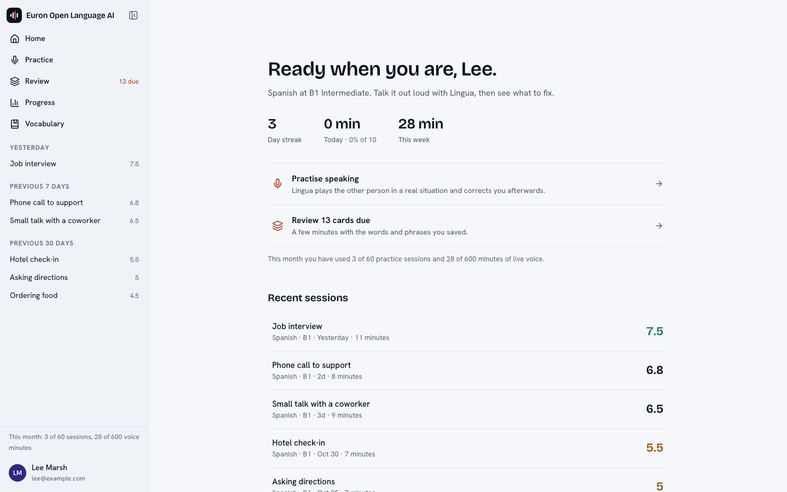 | 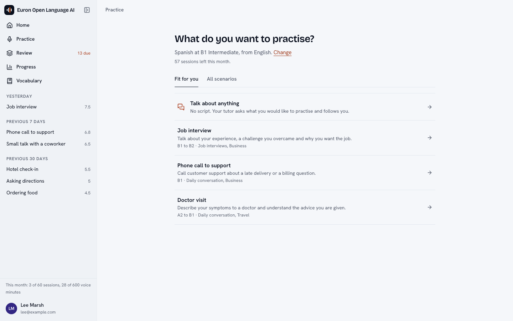 |
| **Home**: your streak, today's minutes against your goal, the cards due and recent sessions | **Practice**: a scenario for your level and goals, or free conversation |
| 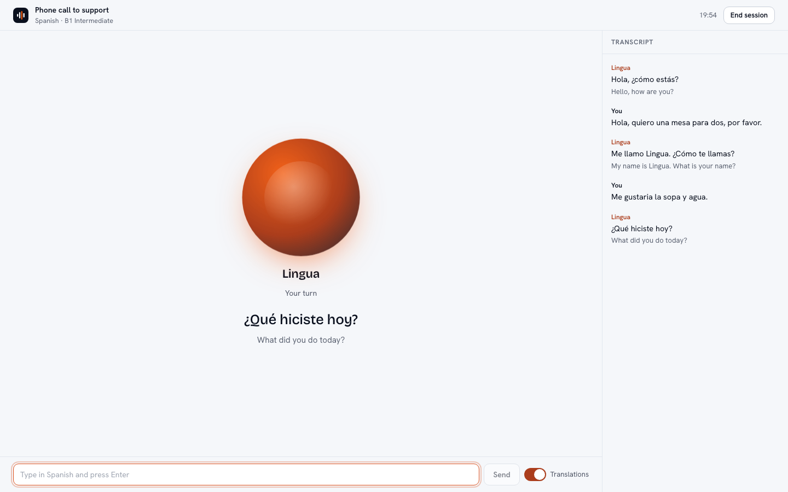 | 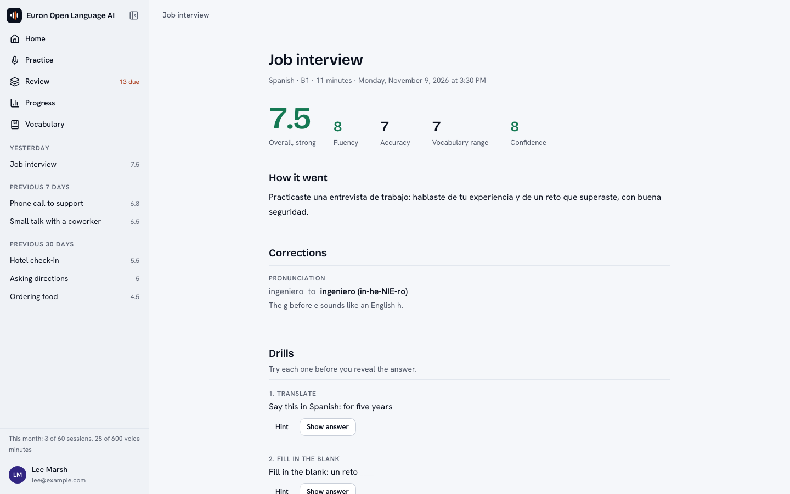 |
| **The room**: the tutor speaks, the meaning shows dimmed, the transcript builds | **Lesson report**: scores, summary, corrections and five drills you check yourself |
| 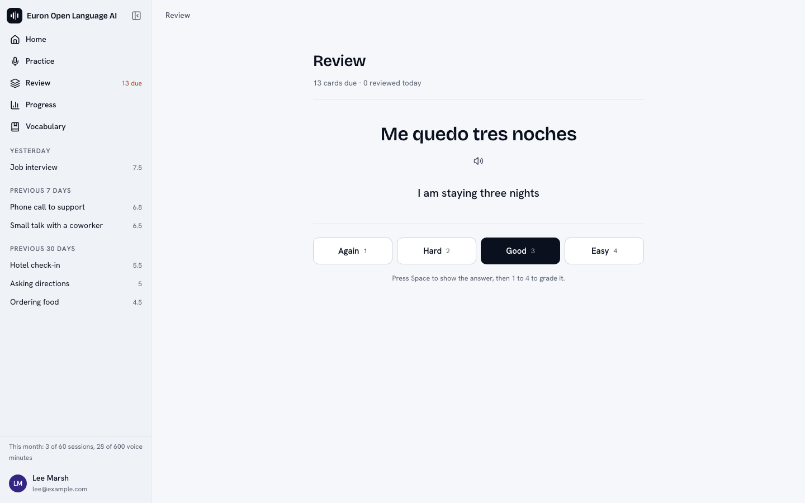 | 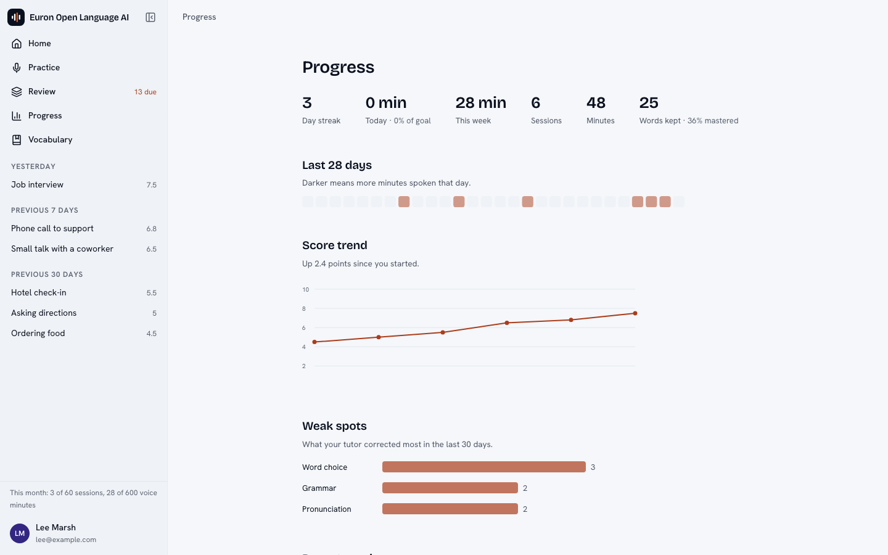 |
| **Review**: flashcards with again, hard, good, easy | **Progress**: 28 days of activity, score trend, what you get wrong most |
| 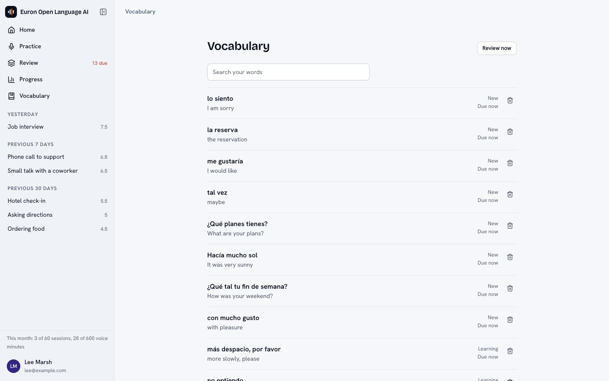 | 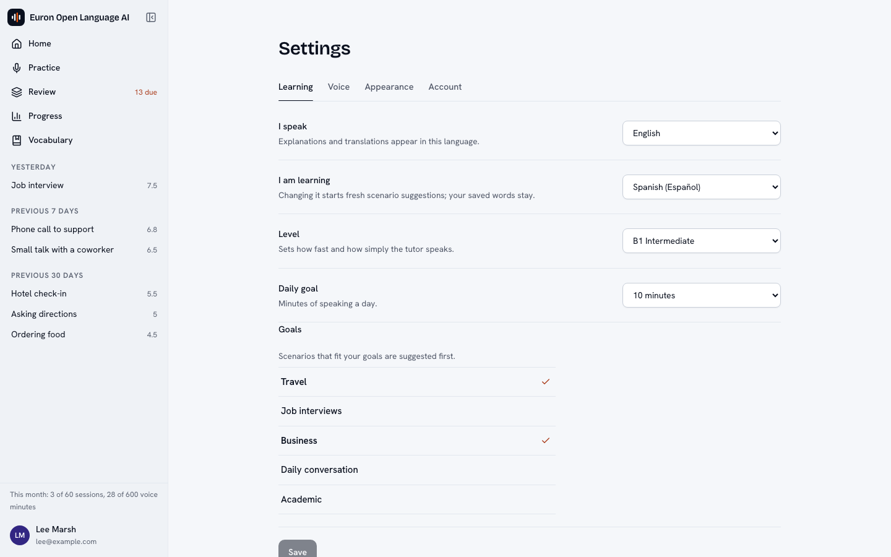 |
| **Vocabulary**: every phrase you saved, with its next review | **Settings**: languages, level, goals, voice and account |
| 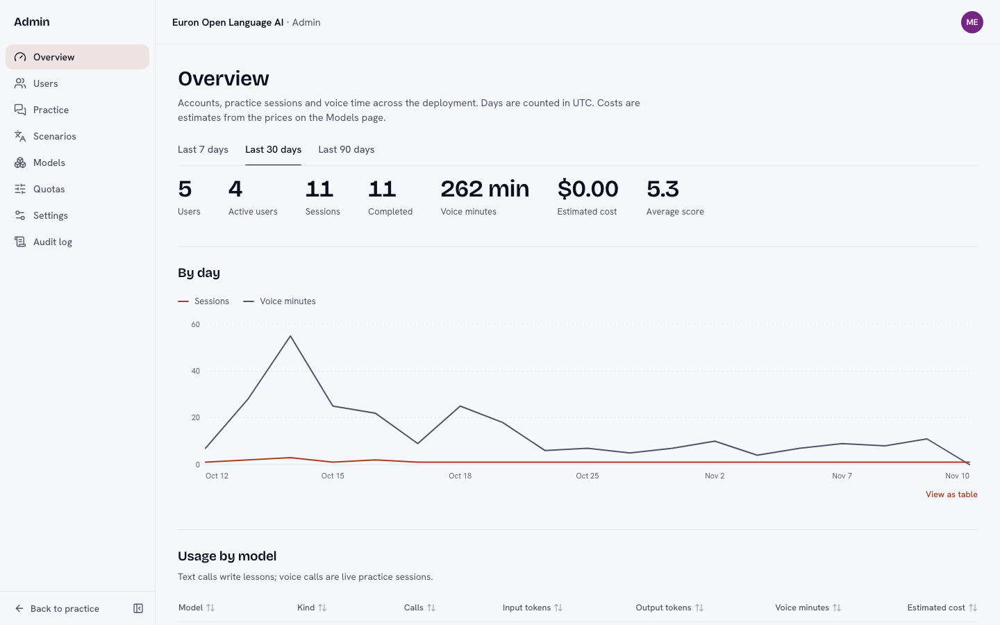 | 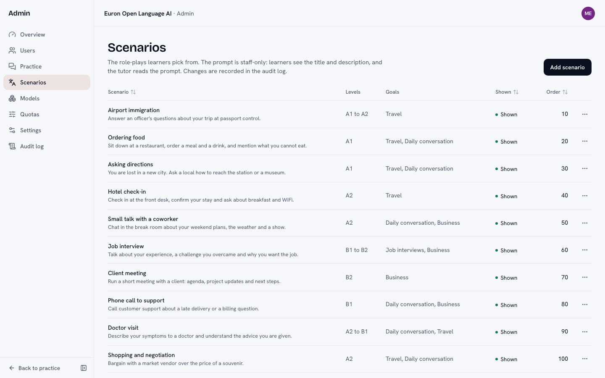 |
| **Admin overview**: users, sessions, voice minutes and cost estimate | **Scenarios**: write, hide and reorder the role-plays |
| 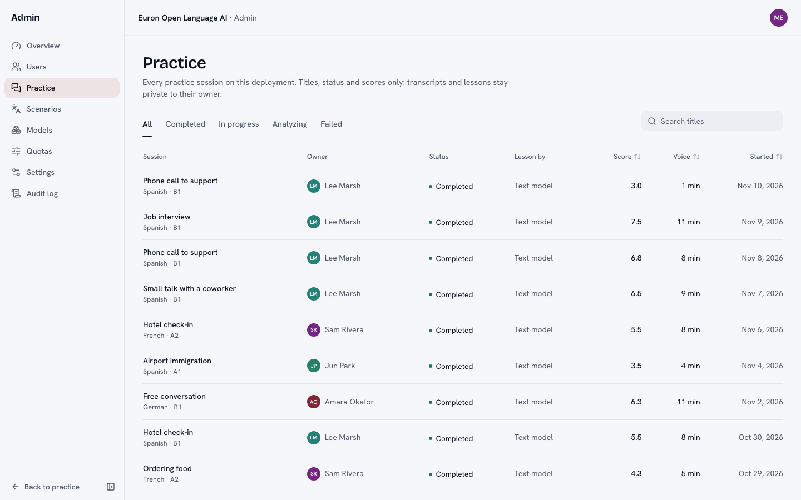 | 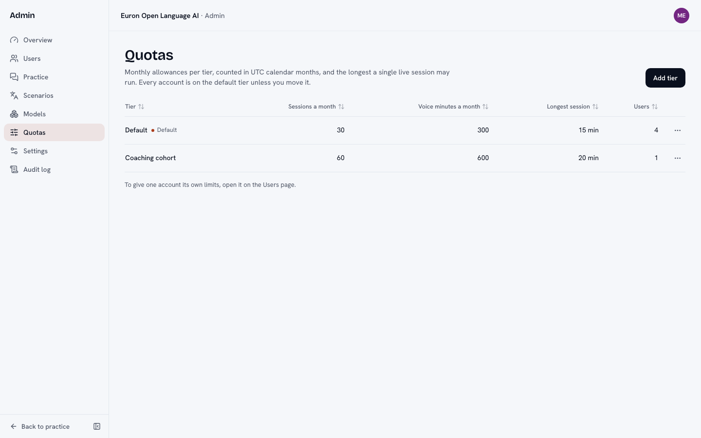 |
| **Practice**: metadata only, with which lesson engine wrote each report | **Quotas**: monthly sessions and voice minutes per tier and per person |
| 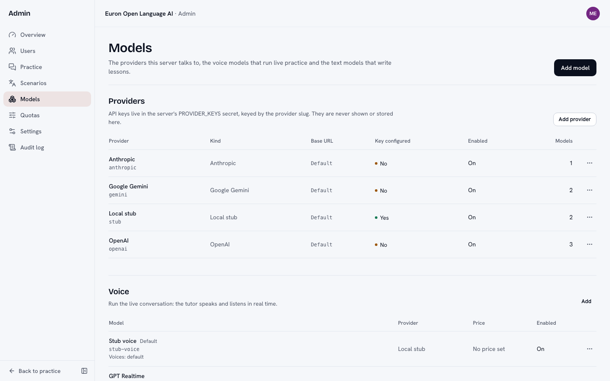 | 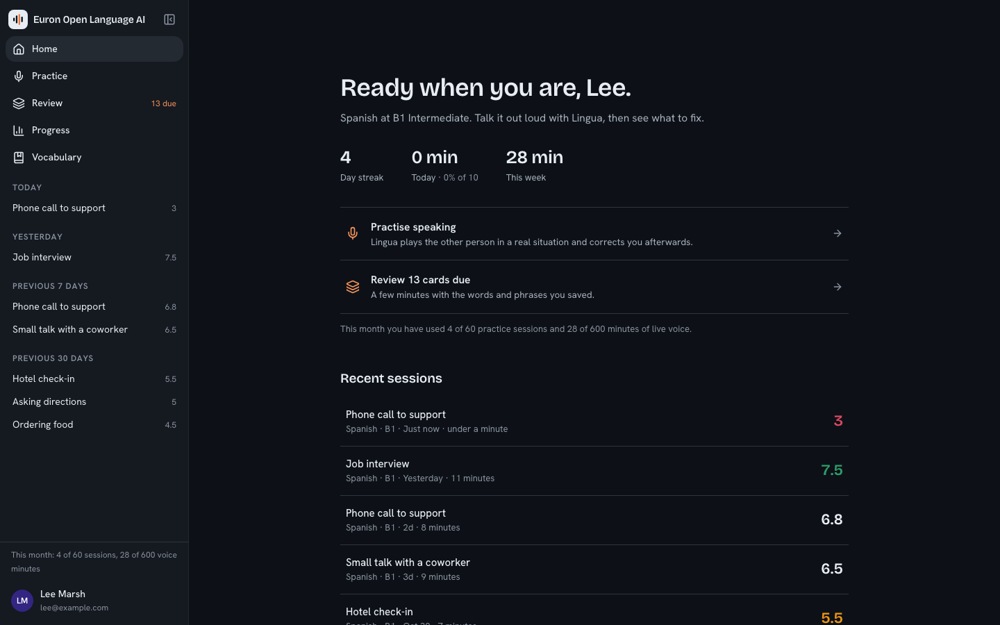 |
| **Models**: voice and text models, prices, a Test button | **Dark theme** throughout |

## ✨ Features

**Learners**
- Onboarding: native language, target language, level, goals and a daily minutes target.
- Scenarios filtered to your level and goals, plus free conversation ("talk about anything").
- A realtime voice room with a tutor orb, live caption, transcript, translation switch, a countdown
  to the session limit and a typed-reply box when the microphone is blocked.
- A lesson report per session: summary, corrections with explanations, key phrases, five drills
  (fill the blank, translate, say this) and four scores.
- A vocabulary deck and spaced-repetition review with keyboard shortcuts.
- A progress page: streak, minutes, 28-day activity, score trend and weak spots.
- Account basics: email verification, password reset, two-factor, sessions, export and delete.

**Admins**
- Users: suspend, ban, set a quota tier or a personal override.
- Scenario library: create, edit, hide, reorder and delete, with an audit entry for each change.
- Models and providers: voice and text models, prices for the cost estimate, a live **Test** button.
- Practice list (metadata only), settings (name, tutor name, house rules, registration, retention),
  integration status and the audit log.

**Operators**
- Monthly session and voice-minute quotas under a per-user advisory lock, with no way to draw past one
  by sending requests in parallel.
- Hard session length, server-measured time, a sweeper for abandoned sessions.
- Terraform for AWS (ECS Fargate, RDS, ElastiCache, SES, KMS, Secrets Manager, CloudFront and WAF).
- A production guard: the API refuses to boot with development secrets or inline jobs.

## 🏗️ Architecture

<p align="center">
  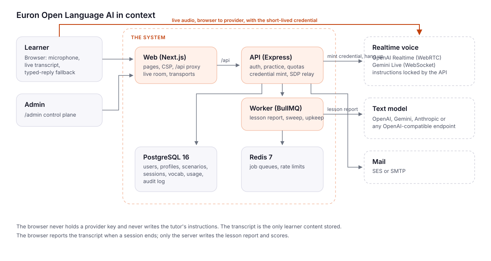
</p>

### One session, from credential to lesson report

<p align="center">
  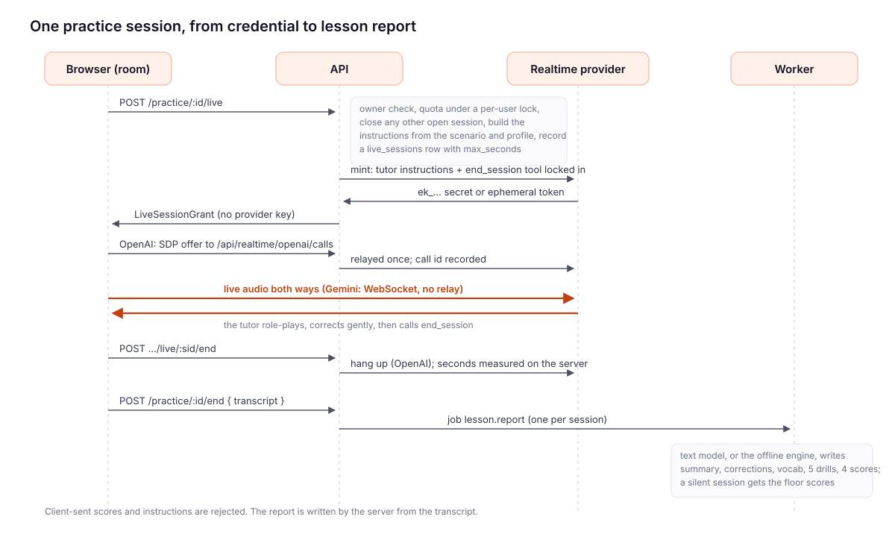
</p>

1. The learner starts a session (`POST /api/practice`): one session of the month's quota is booked.
2. `POST /api/practice/:id/live` checks ownership and quota, builds the tutor's instructions on the
   server and mints the credential. The response is a `LiveSessionGrant`; it never contains a key.
3. The browser connects: OpenAI over plain WebRTC with the offer relayed by the API (which records
   the call so the server can hang up), Gemini Live over WebSocket with a locked ephemeral token, or
   the stub using the grant's script.
4. When the session ends the API books the server-measured seconds and the browser posts its
   transcript. A worker job writes the lesson report; the page polls until it is ready.

### How each provider keeps the tutor on script

| Provider | Credential | What is locked in | At the end |
|---|---|---|---|
| OpenAI Realtime | `client_secrets` with the full session: model, instructions, the `end_session` tool, voice, transcription language, server VAD | Set by the server; the web client never sends `session.update`. OpenAI does not lock the session, so a determined learner could change it from developer tools, which the threat model covers | The server hangs the call up at the end, at the session maximum, or when the sweeper expires it |
| Gemini Live | An ephemeral token constrained to the instructions and model | Locked by Google's `liveConnectConstraints` | The token expires; the sweeper books the time |
| Stub | A signed local token | The server sends the scripted lines to speak | Ended by the browser or the sweeper |

Details: [docs/architecture/realtime-and-providers.md](docs/architecture/realtime-and-providers.md)
and [docs/architecture/lesson-engine.md](docs/architecture/lesson-engine.md).

### Data model

`users` and their sessions and tokens, `learner_profiles`, `scenarios`, `practice_sessions` with
their `corrections` and `drills`, the `vocab_items` deck and `review_log`, `live_sessions` for voice
time, `quota_tiers`, overrides and `usage_daily`, `providers` and `models`, `settings` and the
`audit_log`. One SQL migration, [`db/migrations/0001_init.sql`](db/migrations/0001_init.sql); the
column-level reference is [docs/architecture/data-model.md](docs/architecture/data-model.md).

## 🧰 Tech stack

| Layer | Choice |
|---|---|
| Web | Next.js 15 (App Router), React 19, TanStack Query, Radix UI, Tailwind CSS |
| Voice in the browser | Plain WebRTC for OpenAI Realtime, `@google/genai` for Gemini Live, Web Speech for the stub |
| API | Node.js 22, Express 5, Kysely on PostgreSQL 16, zod |
| Jobs | BullMQ on Redis 7 |
| Text models | OpenAI, Anthropic and Gemini native APIs, and the OpenAI-compatible format, through plain `fetch`; plus the offline engine |
| Mail | Amazon SES (or SMTP, or a local outbox) |
| Infrastructure | Terraform, ECS Fargate, ALB, CloudFront and WAF, RDS, ElastiCache, KMS, SES, Secrets Manager, CloudWatch |
| Local AWS | The Floci emulator (SES, KMS, Secrets Manager) and Mailpit |
| Tooling | pnpm workspaces, Turborepo, TypeScript strict, Vitest, Playwright with axe, ESLint |

## 📋 Prerequisites

- Docker with Compose v2 (about 4 GB of memory for the containers)
- Node.js 22 and pnpm 9 (only to run tests or develop outside Docker)
- For real voice: an OpenAI or Gemini API key, and a browser with a microphone
- For AWS: an account, a domain in Route 53 with an ACM certificate, and Terraform 1.10 or later

No AWS account and no model key are needed to run it locally.

## 🚀 Quickstart

```bash
git clone https://github.com/euron-sde-team/euron-open-language-ai.git
cd euron-open-language-ai
make up      # the stack on emulated AWS, provisioned by the same Terraform as production
make demo    # demo people, six finished lessons for Lee, a deck with cards due
```

Open http://localhost:3640 and sign in as `lee@example.com` (a Spanish learner at B1 with finished
lessons and cards due) or `admin@example.com` (the control plane) with the password `make demo`
prints. Every demo account shares it.

| URL | What |
|---|---|
| http://localhost:3640 | The app (and `/admin`) |
| http://localhost:5116/api/ready | The API readiness check |
| http://localhost:8116 | Mailpit: every email the app sends |
| http://localhost:5209 | The stubs: text model and realtime credential stand-ins |

Locally the lesson report comes from the offline engine and the tutor is the stub voice, so you can
try every screen without a key. `make help` lists every target;
[docs/guides/quickstart-local.md](docs/guides/quickstart-local.md) explains each step.

## 🎙️ Use real voice and text models

1. Put a key in `deploy/compose/.env`: `OPENAI_API_KEY=sk-...` and or `GEMINI_API_KEY=...`, or
   several at once with `PROVIDER_KEYS={"openai":"sk-...","gemini":"..."}`.
2. `make up` again. The starter catalogue lists the realtime models and text models; a provider
   appears as soon as its key is configured.
3. In **Admin, Models**, choose the default voice and text models, add prices if you want a cost
   estimate, and press **Test**: for a voice model it mints a real credential without opening a call.

With a text model configured the lesson report is written by the model (and falls back to the offline
engine if the model fails twice); each report records which engine wrote it. Use headphones: the
browser's echo cancellation does most of the work, headphones do the rest. Details for every
provider: [docs/guides/providers.md](docs/guides/providers.md).

## 🧭 Explore the repository

```
apps/
  api/          Express API and worker (one image, two commands)
    src/
      routes/                 every endpoint, with its contract in a doc comment
      services/practice/      sessions, tutor prompts, live voice, transcript, review scheduling
      services/practice/lesson/  the LLM engine and the deterministic offline engine
      domain/languages.ts     the language table: names, transcription codes, speech locales
      integrations/realtime/  OpenAI client secrets and hang-up, Gemini ephemeral tokens, stub
      integrations/llm/       text models: OpenAI, Anthropic, Gemini, OpenAI-compatible
      jobs/                   lesson report, hang up, sweep, upkeep
  web/          Next.js: the app, the live room, review, progress, /admin
    src/lib/realtime/         the three browser transports
  stubs/        dependency-free provider stand-ins for development and tests
packages/
  types/        the API contract
  api-client/   typed client for web and React Native
  ui/           design tokens and primitives
db/migrations/  one SQL migration
deploy/compose/ the local stack (Floci, Mailpit, stubs)
infra/          Terraform modules and environments, Dockerfiles
docs/           architecture, ADRs, API, guides
e2e/            Playwright end-to-end tests
```

[docs/guides/walkthrough.md](docs/guides/walkthrough.md) follows one session from sign-up to review,
naming every file on the way.

## 🔌 API

- [REST contract](docs/api/rest-contract.md): envelopes, error codes, pagination, auth modes and
  rate limits.
- [Realtime](docs/api/realtime.md): live session grants, the three transports, the SDP relay, and
  ending a session.
- [OpenAPI 3.1](docs/api/openapi.yaml): 81 operations, generated from the route files
  (`pnpm openapi`, checked in CI with `--check`).
- [`@open-language/api-client`](packages/api-client): the typed client the web app uses, ready
  for a mobile app.

```bash
# Start a free-conversation session from the command line
TOKEN=$(curl -s localhost:5116/api/auth/login -H 'content-type: application/json' \
  -d '{"login":"lee@example.com","password":"<demo password>"}' | jq -r .accessToken)
curl -s localhost:5116/api/practice -H "authorization: Bearer $TOKEN" \
  -H 'content-type: application/json' -d '{}'
```

## ⚙️ Configuration

Every variable is declared once in [`apps/api/src/core/config.ts`](apps/api/src/core/config.ts) and
documented in [docs/guides/configuration.md](docs/guides/configuration.md). A production API refuses
to boot with development secrets, a localhost web URL, missing CORS origins, mail to a local outbox
or inline jobs.

## ☁️ Deploy to AWS

```bash
make aws-plan ENV=aws-dev     # terraform plan for infra/terraform/envs/aws-dev
make aws-deploy ENV=aws-dev   # build and push images, apply, run migrations
```

ECS Fargate behind one load balancer, RDS PostgreSQL, ElastiCache Redis, SES, Secrets Manager and
KMS, with CloudFront and WAF optional in dev and on in prod. Provider keys live in Secrets Manager,
never in the database. [docs/guides/deploy-aws.md](docs/guides/deploy-aws.md) walks through the first
deploy and [docs/guides/operations.md](docs/guides/operations.md) through running it.

## 🔐 Security model

- **Ownership is a 404.** Every practice session, transcript, report, deck and live session route is
  scoped by owner; another person's session does not exist for you.
- **Admins cannot read practice.** The control plane shows metadata, counts and scores; there is no
  endpoint that returns someone's transcript, corrections or deck.
- **Untrusted text is fenced.** A transcript reaches a model inside a marked block it is told to treat
  as material, never as instructions, and every model output is checked by a schema before it is
  stored.
- **Keys never reach the browser.** Provider keys come from the environment or Secrets Manager; the
  browser gets a credential for one session that expires within minutes.
- **Strict headers.** A per-request Content-Security-Policy with a nonce, `connect-src` limited to the
  realtime origin, and microphone allowed for this origin only.

The full picture, including what is not enforceable (a learner can type a different transcript of
their own practice; an OpenAI session can be altered from developer tools until the server hangs it
up): [docs/architecture/security.md](docs/architecture/security.md) and
[docs/architecture/threat-model.md](docs/architecture/threat-model.md).

## 🧪 Testing

```bash
pnpm lint && pnpm typecheck && pnpm test        # unit tests in every package
make test-integration                          # the API against real Postgres and Redis
make e2e                                       # Playwright against the running stack
```

| Suite | Count | Where |
|---|---|---|
| API unit | 102 | `apps/api/test/unit` |
| API integration | 166 | `apps/api/test/integration`, against Postgres and Redis with the stubs in-process |
| Web unit and components | 115 | `apps/web/test` |
| API client and UI kit | 50 | `packages/api-client/test`, `packages/ui/test` |
| Stubs | 5 | `apps/stubs/test` |
| End to end | 11 | `e2e/tests`, Chromium against the stack on the stub voice, including axe in both themes |

The integration suite proves the guarantees above: another user gets 404 on every practice route, a
client cannot send scores or instructions, the instructions locked into an OpenAI client secret come
from the scenario and profile, parallel requests cannot draw past a quota, deleting a session does not
give quota back, and no response or table ever contains a provider key.
[docs/guides/testing.md](docs/guides/testing.md) has the details.

## 📖 Documentation

| | |
|---|---|
| Architecture | [HLD](docs/architecture/HLD.md), [LLD](docs/architecture/LLD.md), [lesson engine](docs/architecture/lesson-engine.md), [realtime and providers](docs/architecture/realtime-and-providers.md), [data model](docs/architecture/data-model.md), [quotas](docs/architecture/quotas.md) |
| Security | [security](docs/architecture/security.md), [threat model](docs/architecture/threat-model.md) |
| Decisions | [architecture decision records](docs/architecture/adr) |
| API | [REST contract](docs/api/rest-contract.md), [realtime](docs/api/realtime.md), [OpenAPI](docs/api/openapi.yaml) |
| Guides | [quickstart](docs/guides/quickstart-local.md), [walkthrough](docs/guides/walkthrough.md), [configuration](docs/guides/configuration.md), [providers](docs/guides/providers.md), [add a language](docs/guides/add-a-language.md), [write a scenario](docs/guides/write-a-scenario.md), [deploy to AWS](docs/guides/deploy-aws.md), [operations](docs/guides/operations.md), [testing](docs/guides/testing.md), [troubleshooting](docs/guides/troubleshooting.md), [mobile clients](docs/guides/mobile-clients.md) |

## 🗺️ Roadmap

- A server sideband for OpenAI sessions, so the server can also watch and correct the live session.
- Pronunciation scoring from the audio, not only the transcript.
- Tutor personas and a per-learner pace.
- A React Native client on the existing native token mode and API client.
- Translations in the learner's own language for the stub and the offline engine (today English).

## ❓ FAQ

<details>
<summary><b>Do I need an API key to try it?</b></summary>

No. `make up && make demo` runs everything with deterministic stand-ins: the lesson report comes
from the offline engine and the tutor speaks scripted lines with your browser's built-in voice while
you type or dictate. A real voice conversation needs an OpenAI or Gemini key.
</details>

<details>
<summary><b>How good is the offline lesson engine?</b></summary>

It is a stand-in, not a grader. It measures simple things about what you said (length, variety of
words, hesitations, repeats, falling back to your own language) and builds drills from the phrases the
tutor glossed. It is deterministic, so the same practice gives the same report, which makes it good
for trying the product and for tests. For real corrections configure a text model.
</details>

<details>
<summary><b>Which models can I use?</b></summary>

For the live conversation, OpenAI Realtime models (`gpt-realtime`, `gpt-realtime-mini`) and Gemini
Live models. For the lesson report, any OpenAI, Anthropic or Gemini text model, or anything that
speaks the OpenAI chat format (OpenRouter, Groq, a local Ollama).
</details>

<details>
<summary><b>Which languages are supported?</b></summary>

Twenty-one are listed, from Spanish, French, German and Japanese to Hindi, Tamil and Arabic. The
voice models decide how well each one is spoken; the app only needs a row in
[`domain/languages.ts`](apps/api/src/domain/languages.ts).
[docs/guides/add-a-language.md](docs/guides/add-a-language.md) shows how to add one.
</details>

<details>
<summary><b>Can admins listen to or read my practice?</b></summary>

No. Audio never reaches the server at all: it goes from your browser to the voice provider.
Transcripts are stored for your lesson report and only you can read them. Admins see titles,
counts, scores and minutes.
</details>

<details>
<summary><b>My network blocks the voice connection. What can I do?</b></summary>

For OpenAI the handshake goes through this app's own origin, which fixes networks that only block
the provider's API domain. Networks that block WebRTC media altogether (some VPNs and corporate
firewalls) need another network; a phone hotspot usually works.
[docs/guides/troubleshooting.md](docs/guides/troubleshooting.md) has more.
</details>

## 🤝 Contributing, security and license

- [CONTRIBUTING.md](CONTRIBUTING.md): how to set up, the checks a pull request must pass, and the
  coding conventions.
- [SECURITY.md](SECURITY.md): how to report a vulnerability privately.
- [CODE_OF_CONDUCT.md](CODE_OF_CONDUCT.md).
- [MIT License](LICENSE).
