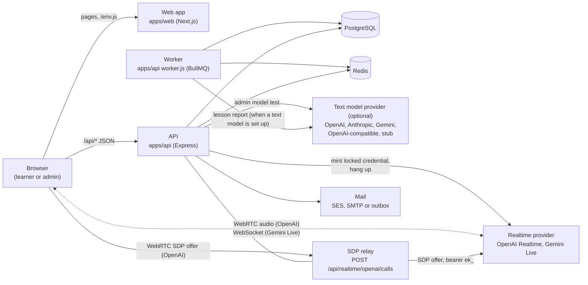

# High-level design

Euron Open Language AI is a self-hosted AI language tutor over live voice. A learner tells
it which language they speak, which one they want to learn and at what level. They pick a
scenario (ordering food, a job interview, asking directions) or just talk, and a realtime
voice model holds the conversation in the browser, speaking mostly the target language with a
short translation after every sentence. When the learner ends the session the server writes a
lesson report: four scores, the corrections worth making, vocabulary to keep and five
drills. Saved phrases join a spaced-repetition deck the learner reviews daily, and a progress
page shows the streak, minutes and score trend.

One deployment serves one organisation or community ([ADR 0002](adr/0002-single-tenant.md)).
Admins run it from `/admin` in the same web app: accounts, quota tiers and overrides,
providers and models, scenarios, deployment settings, practice-session metadata and the audit
log. Admins never read anyone's transcripts or lesson reports.

This page describes what runs, where data lives and how a request travels. Deeper topics:

| Topic | Page |
| --- | --- |
| Modules and request flows inside the API and the web app | [LLD.md](LLD.md) |
| The tutor's prompt, the two lesson engines, the deck's scheduling | [lesson-engine.md](lesson-engine.md) |
| Realtime providers, locked instructions, session length and hang-up | [realtime-and-providers.md](realtime-and-providers.md) |
| Every table | [data-model.md](data-model.md) |
| Monthly practice sessions and voice minutes | [quotas.md](quotas.md) |
| Security controls | [security.md](security.md) |
| STRIDE analysis and residual risks | [threat-model.md](threat-model.md) |
| Decisions and their trade-offs | [adr/](adr/README.md) |
| The HTTP contract | [../api/rest-contract.md](../api/rest-contract.md), [../api/realtime.md](../api/realtime.md) |

Code paths are relative to the repository root.

## 1. System context

Two roles exist (`users.role`):

| Role | Can open | Enforced in |
| --- | --- | --- |
| `USER` | Their own profile, practice sessions, lesson reports, vocabulary, preferences, usage and sessions | Every practice, vocabulary and review query is scoped by owner (`ownedPractice` in [`apps/api/src/services/practice/practice.service.ts`](../../apps/api/src/services/practice/practice.service.ts)); another learner's session is a 404 |
| `ADMIN` | The above for their own account, plus `/admin` | `requireAdmin` in [`apps/api/src/core/context.ts`](../../apps/api/src/core/context.ts), called by every admin service function |

The outside systems:

| System | Used for | Code |
| --- | --- | --- |
| Text model providers (optional) | Writing the lesson report when one is configured, and the admin "Test" button | [`apps/api/src/integrations/llm/`](../../apps/api/src/integrations/llm/index.ts) |
| Realtime providers | Minting short-lived credentials with the tutor's instructions locked in; hanging up OpenAI calls | [`apps/api/src/integrations/realtime/`](../../apps/api/src/integrations/realtime/index.ts) |
| Mail (SES v2, SMTP, or a file outbox in development) | Verification, password reset, the admin bootstrap link | [`apps/api/src/integrations/mail/mailer.ts`](../../apps/api/src/integrations/mail/mailer.ts) |

A text model is optional. Without one the deterministic offline lesson engine writes the
report ([lesson-engine.md](lesson-engine.md)); a voice model is required to hold a
conversation (the stub voice works with no key).

Voice media goes straight between the browser and the realtime provider. The API mints a
credential and, for OpenAI, relays only the SDP handshake. No audio crosses the stack.

Provider API keys are read from the environment (or Secrets Manager on AWS) on every call.
They are never stored in the database and never returned by an endpoint
([ADR 0004](adr/0004-text-model-adapters.md)).

## 2. Containers

| Container | Source | Image | Listens | Role |
| --- | --- | --- | --- | --- |
| Web app | `apps/web` (Next.js 15, standalone) | [`infra/docker/web.Dockerfile`](../../infra/docker/web.Dockerfile) | 3640 on the host locally | Pages, `/env.js` runtime config, the per-request CSP. In development it proxies `/api/*` to the API ([`apps/web/next.config.ts`](../../apps/web/next.config.ts)) |
| API | [`apps/api/src/index.ts`](../../apps/api/src/index.ts) | [`infra/docker/api.Dockerfile`](../../infra/docker/api.Dockerfile) | 5116 | REST under `/api`, the SDP relay, `/up` and `/api/ready` |
| Worker | [`apps/api/src/worker.ts`](../../apps/api/src/worker.ts) | API image, `node dist/worker.js` | none | BullMQ workers for the `practice` and `maintenance` queues, and the repeatable schedules |
| Migrate (one-off) | [`db/migrate.ts`](../../db/migrate.ts) | API image | none | Applies pending SQL migrations from `db/migrations` |
| CLI (one-off) | [`apps/api/src/cli.ts`](../../apps/api/src/cli.ts) | API image, `node dist/cli.js` | none | `admin:create` and `demo:seed` |
| Stubs (development and tests) | [`apps/stubs/server.mjs`](../../apps/stubs/README.md) | [`infra/docker/stubs.Dockerfile`](../../infra/docker/stubs.Dockerfile) | 5209 | Deterministic text model and realtime credential endpoints |

Data stores:

| Store | Holds |
| --- | --- |
| PostgreSQL | Everything durable: accounts, sessions, learner profiles, scenarios, practice sessions with their transcripts, corrections and drills, the vocabulary deck, live sessions, quotas, usage counts, settings, audit log ([data-model.md](data-model.md)) |
| Redis | BullMQ queues, rate limit counters. Nothing in Redis is the only copy of anything; job payloads carry ids only, never transcript text |

There is no object storage: nothing is uploaded, and the learner's voice is never recorded
by this system.

## 3. The main journey

1. **Sign up and onboard.** The learner creates an account and confirms their email. A four
   step wizard sets the native language, the target language, the level (A1 to C2) and goals,
   and a daily minutes target. `PUT /api/me/profile` with `onboardingComplete: true` finishes
   it. Until then starting a session is `409 PROFILE_INCOMPLETE`.
2. **Pick a scenario.** `GET /api/scenarios?forProfile=true` lists the active role-plays that
   fit the learner's level and goals. "Talk about anything" is free conversation (a scenario
   of none), available while the `freeConversation` setting is on.
3. **Start.** `POST /api/practice` checks the monthly session quota under a per-user lock,
   books one session and inserts the `practice_sessions` row in `IN_PROGRESS`, copying the
   languages and level from the profile.
4. **Talk.** The room calls `POST /api/practice/:id/live`. The server builds the tutor's
   instructions from the stored session and the scenario, caps the session by the tier's
   session length and the minutes left this month, and asks the provider for a short-lived
   credential with those instructions locked in. The browser connects directly (OpenAI via
   the SDP relay, Gemini Live over its WebSocket, or the local stub). The tutor speaks
   first.
5. **End.** The learner presses End session (or the countdown reaches zero). The browser
   closes the live session (`.../live/:sid/end`, which books server-measured seconds) and
   posts its transcript to `POST /api/practice/:id/end`. The server cleans the transcript,
   measures the duration from its own live-session clocks, marks the session `ANALYZING` and
   queues `practice.analyze`.
6. **Lesson report.** The worker runs the lesson engine: the configured text model, or the
   deterministic offline engine when none is set up or the model fails twice. The report
   (summary, scores, corrections, vocabulary suggestions, five drills) is stored in one
   transaction and the session becomes `COMPLETED`. The web app polls every 1.5 seconds
   while it is `ANALYZING`. Scores are never accepted from the client
   ([ADR 0007](adr/0007-browser-transcript-server-scoring.md)).
7. **Vocabulary and review.** The learner saves suggested phrases to their deck. Each card is
   scheduled SM-2 style ([ADR 0008](adr/0008-spaced-repetition-on-the-server.md)); `/review`
   serves the cards that are due and the server schedules the next review from the grade.
8. **Progress.** `GET /api/me/dashboard` returns the streak, minutes, a 28 day activity
   chart, the score trend, deck counts and the most frequent kinds of mistake.

## 4. Failure behaviour

| Failure | Effect |
| --- | --- |
| No text model configured | Nothing breaks: the offline engine writes the report and the session records `engine = offline` |
| Text model down or returns bad JSON | One retry inside the call, then the offline engine writes the report (`engine = offline`). The learner still gets a report |
| The report job itself fails | The session becomes `FAILED` with a safe message; `POST /api/practice/:id/retry` writes it again from the stored transcript. Quota is not given back |
| Realtime provider refuses to mint | `502 REALTIME_UNAVAILABLE`; the live session row is closed at zero seconds |
| No voice model configured | `503 NO_REALTIME_MODEL` when starting a session |
| Network blocks the provider | OpenAI's handshake goes through the API relay; WebRTC media can still fail on networks that block UDP, and the room says so and offers typing ([troubleshooting](../guides/troubleshooting.md)) |
| Browser vanishes mid-session | The sweeper (every minute) expires the live session after its window and books its full length; for OpenAI it also queues a hang-up |
| Redis down | Readiness fails. Rate limits fall back to per-task memory. Queued jobs wait |
| Worker down | Ended sessions stay `ANALYZING` until it returns. The job is idempotent, so replays are safe |

## 5. Deployment

Locally, `make up` runs the whole stack in Docker on emulated AWS (Floci) with the same
Terraform modules used in production ([quickstart](../guides/quickstart-local.md)). On AWS,
[`infra/terraform/modules/deployment`](../../infra/terraform/modules/deployment/main.tf)
creates the network, RDS PostgreSQL, ElastiCache Redis, KMS, Secrets Manager, SES, ECR,
an application load balancer (optionally behind CloudFront) and three ECS Fargate services:
`api` (routes `/api/*` and `/up`), `web` (everything else) and `worker` (no inbound
traffic), plus one-off `migrate` and `admin` tasks ([deploy-aws](../guides/deploy-aws.md)).
