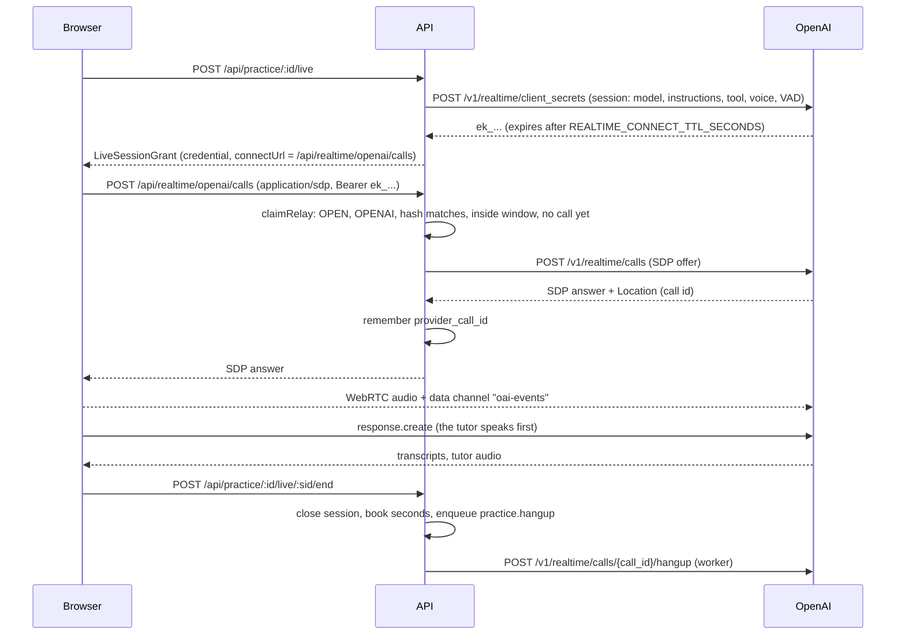

# Low-level design

How the code is organised and how each request travels through it. The big picture is in
[HLD.md](HLD.md); the HTTP contract is in [rest-contract.md](../api/rest-contract.md).

## 1. API layers

Pattern: routes, controllers, services, repositories and presenters, with integrations at
the edge ([ADR 0001](adr/0001-monorepo-stack.md)).

| Layer | Folder | Rule |
| --- | --- | --- |
| Routes | `apps/api/src/routes/*.routes.ts` | Mount path, guards (`authenticate`, `rateLimit`) and a doc comment per endpoint. `scripts/gen-openapi.ts` reads these files and [`routes/index.ts`](../../apps/api/src/routes/index.ts) |
| Controllers | `apps/api/src/controllers` | Parse input with strict zod schemas (`core/validate.ts`), call one service, write the response. No business rules |
| Services | `apps/api/src/services` | Business rules and transactions. Take an `Actor`, never an Express request, so jobs and tests can call them |
| Repositories | `apps/api/src/repositories` | Reusable queries (users, sessions, tokens, audit, keyset cursors) |
| Presenters | `apps/api/src/presenters` | Database rows to DTOs from `packages/types` |
| Domain | `apps/api/src/domain` | Pure tables and rules: [`languages.ts`](../../apps/api/src/domain/languages.ts), display names, usernames |
| Integrations | `apps/api/src/integrations` | Text model adapters (`llm/`), realtime adapters (`realtime/`), mail, Redis |
| Jobs | `apps/api/src/jobs` | Named handlers with typed payloads (`registry.ts`) |

Side effects that must wait for a commit (enqueueing a job) go through `Effects` in
[`core/effects.ts`](../../apps/api/src/core/effects.ts): `withTransaction(fn)` hands the
function a transaction and an `Effects` collector, and jobs are enqueued only after the
commit. A rolled-back transaction enqueues nothing.

### The practice module

| File | Responsibility |
| --- | --- |
| [`services/practice/practice.service.ts`](../../apps/api/src/services/practice/practice.service.ts) | Start, read, list, end, retry and delete a practice session. `ownedPractice` is the owner gate |
| [`services/practice/live.service.ts`](../../apps/api/src/services/practice/live.service.ts) | Mint live sessions, end them, the sweeper, the relay gate (`claimRelay`), hang-up |
| [`services/practice/sessions.ts`](../../apps/api/src/services/practice/sessions.ts) | Close a live session and book its server-measured seconds |
| [`services/practice/prompts.ts`](../../apps/api/src/services/practice/prompts.ts) | The tutor's instructions, the lesson report's prompt, `fence()`, the `end_session` tool |
| [`services/practice/transcript.ts`](../../apps/api/src/services/practice/transcript.ts) | `cleanTranscript`: the clamps applied to the browser's transcript |
| [`services/practice/ai.ts`](../../apps/api/src/services/practice/ai.ts) | `generateJson`: one structured text-model call with a retry and usage booking |
| [`services/practice/lesson/`](../../apps/api/src/services/practice/lesson/index.ts) | The lesson engine: `llm.ts`, `offline.ts` and `index.ts` (`runLesson`, which picks one) |
| [`services/practice/srs.ts`](../../apps/api/src/services/practice/srs.ts) | SM-2 style scheduling as pure functions |
| [`services/profile.service.ts`](../../apps/api/src/services/profile.service.ts) | The learner profile, validated against the language table |
| [`services/scenario.service.ts`](../../apps/api/src/services/scenario.service.ts) | Scenarios for learners and the admin CRUD (audited) |
| [`services/vocab.service.ts`](../../apps/api/src/services/vocab.service.ts), [`review.service.ts`](../../apps/api/src/services/review.service.ts) | The deck and the daily review |
| [`services/dashboard.service.ts`](../../apps/api/src/services/dashboard.service.ts) | Streak, minutes, activity, score trend, weak spots, computed in SQL |
| [`services/quota.service.ts`](../../apps/api/src/services/quota.service.ts) | Limits, the advisory lock, usage booking |
| [`jobs/practice.jobs.ts`](../../apps/api/src/jobs/practice.jobs.ts) | `practice.analyze`, `practice.hangup`, `practice.sweep` |

## 2. Jobs and schedules

| Job | Queue | Payload | Options | Trigger |
| --- | --- | --- | --- | --- |
| `practice.analyze` | practice | `{ practiceId, version }` | 2 attempts, removed on complete, last 100 failures kept | End, retry |
| `practice.hangup` | practice | `{ sessionId }` | 3 attempts | An OpenAI live session with a known call id was closed |
| `practice.sweep` | practice | none | every 60 s | Worker schedule |
| `maintenance.lift-suspensions` | maintenance | none | every 5 min | Worker schedule |
| `maintenance.purge-accounts` | maintenance | none | every 6 h | Worker schedule |
| `maintenance.retention` | maintenance | none | every 6 h | Worker schedule |

Defaults for every queue: 5 attempts, exponential backoff from 5 s. The worker runs the
`practice` queue with concurrency 8 and `maintenance` with 2. With `JOBS_MODE=inline` the
handler runs in the API process right after commit (tests and tiny installs; refused in
production by `assertProductionConfig`). Payloads are ids and a version stamp only: the
transcript is read from the row, never carried through Redis.

## 3. Request flows

### 3.1 The profile

`GET /api/me/profile` creates the row on first read (native English, target Spanish, level
A1, goal `DAILY`, 10 minutes a day, onboarding not complete). `PUT /api/me/profile` changes
any field. Language codes are checked against the table in `domain/languages.ts`:
`400 LANGUAGE_UNKNOWN`, `400 LANGUAGE_NOT_TEACHABLE` (a target must be `teachable`),
`400 LANGUAGE_SAME` (native equals target) and `400 GOALS_REQUIRED`. A change never rewrites
past sessions, because a session copies the profile when it starts.

### 3.2 Choosing a scenario

`GET /api/scenarios` returns active scenarios in `(sort_order, created_at, id)` order without
the role-play text. With `?forProfile=true` it keeps those whose level range contains the
learner's level and that share at least one goal (a scenario with no goals suits everyone).
The role-play text (`prompt_template`) is staff-only and appears only in
`/api/admin/scenarios`.

### 3.3 Starting a session

`POST /api/practice` with `{ scenarioId? }`. `startPractice`:

1. The profile must have `onboarding_complete` (`409 PROFILE_INCOMPLETE`).
2. A scenario id must be active (`400 SCENARIO_NOT_FOUND`); no id means free conversation,
   refused with `403 FEATURE_DISABLED` when `features.freeConversation` is off.
3. A usable voice model must exist (`503 NO_REALTIME_MODEL`). The text model chosen now (the
   default, or none) is remembered on the row.
4. In one transaction: take the user's quota lock, check the monthly limit
   (`429 QUOTA_EXCEEDED`), insert the `practice_sessions` row in `IN_PROGRESS` with the
   profile's languages and level, and book `sessions: 1` in `usage_daily`.
5. Respond `201` with the `PracticeSession`.

### 3.4 Minting a live session

`POST /api/practice/:id/live` (the body is ignored). `startLive` in `live.service.ts`:

1. Owner check (404 otherwise); `409 PRACTICE_ENDED` unless the session is `IN_PROGRESS`.
2. Resolves the realtime model: the session's, else the user's default, else the deployment
   default (`503 NO_REALTIME_MODEL`). The voice is the user's preference if the model offers
   it, else the model's first voice.
3. Builds the instructions with `tutorInstructions` from the stored session (language codes,
   level), the scenario's role-play text, the tutor name and house rules from settings.
   Nothing from the request enters them.
4. In one transaction: take the quota lock, close any other `OPEN` session of this user
   (booking its time), compute `max_seconds` with `voiceSecondsAllowed` (`429
   QUOTA_EXCEEDED` when under 30 seconds are left), insert the `live_sessions` row.
5. After commit, call the provider adapter's `mint` (so a slow provider never holds the
   lock) with the transcription code from `domain/languages.ts`. Store the SHA-256 of the
   credential on the row.
6. Return the `LiveSessionGrant`: `id`, `provider`, `credential`, `model`, `voice`,
   `connectUrl`, `expiresAt`, `maxSeconds`, `scenario`, the two languages, `speechLocale`
   and, for the stub only, `script`.
7. If minting fails, the row is closed at zero seconds and the call answers `502
   REALTIME_UNAVAILABLE`.

A session can open several live sessions (a reconnect after a drop). The partial unique index
`live_sessions_one_open` makes "one open live session per user" a database guarantee.

### 3.5 OpenAI: WebRTC through the relay, and hang-up

The browser transport ([`apps/web/src/lib/realtime/openai.ts`](../../apps/web/src/lib/realtime/openai.ts))
is plain WebRTC with no SDK. It never sends `session.update`. The relay accepts an SDP body
up to 64 KB, is rate limited to 30 requests a minute per IP, and accepts a credential only
once (the call id is set on first use) and only within its connection window. When OpenAI
answers with an error the relay returns 502. See
[realtime-and-providers.md](realtime-and-providers.md) for why.

### 3.6 Gemini Live

The API calls `authTokens.create` (v1alpha) with `uses: 1`, `newSessionExpireTime` at the end
of the connection window, `expireTime` at the end of the session's allowed length, and
`liveConnectConstraints` carrying the model, system instruction, the `end_session` tool, the
voice and the transcription settings. The grant's credential is the token name.

The browser ([`apps/web/src/lib/realtime/gemini.ts`](../../apps/web/src/lib/realtime/gemini.ts))
opens `@google/genai` live with the token as the API key on `v1alpha`. Microphone audio is
resampled to 16 kHz PCM16 and streamed; the model's 24 kHz PCM16 is scheduled on an
AudioContext and dropped on interruption. Gemini calls are not hung up by the server; the
token's `expireTime` bounds them.

### 3.7 The stub transport

For development, the demo and tests without a key. The API signs a `stub_...` token (HMAC
with `JWT_SECRET`) and returns `script`: lines in the learner's target language, each with a
parenthetical translation (`stubScript` in `domain/languages.ts`). The browser
([`apps/web/src/lib/realtime/stub.ts`](../../apps/web/src/lib/realtime/stub.ts)) speaks the
main part of each line with `speechSynthesis` in the target language's locale (silent and
quick under automation), shows the translation in the transcript, and the learner types or
dictates where the browser offers speech recognition. The tutor speaks the first line when
the room opens and the next one after each thing the learner says; after the last line it
says the script is over. An admin cannot create a stub provider when
`NODE_ENV=production` (`400 STUB_IN_PRODUCTION`), and the starter catalogue adds it only
outside production. The stub translations are always English, whatever the learner's native
language is ([security.md](security.md#14-limitations)).

### 3.8 Ending a live session

`POST /api/practice/:id/live/:sid/end` (owner only, `404 LIVE_SESSION_NOT_FOUND` otherwise).
`closeSession` locks the row, computes seconds as `min(max_seconds, now - created_at)`, marks
it `ENDED`, books `voice_seconds` in `usage_daily`, and queues `practice.hangup` when an
OpenAI call id is known. Ending an already closed session returns its stored seconds
(idempotent). The response carries the minutes left this month.

The room ends the conversation when the learner presses **End session** or its countdown from
`maxSeconds` reaches zero
([`apps/web/src/components/room/room-view.tsx`](../../apps/web/src/components/room/room-view.tsx)).
The tutor is told to call the no-argument `end_session` tool after a goodbye; the web
transports do not act on that call today, so the learner presses End session
([security.md](security.md#14-limitations)).

### 3.9 Ending the practice session and the report

`POST /api/practice/:id/end` with `{ transcript: [{ role, text }] }`. The schema is strict, so
a body carrying scores is a `400 VALIDATION_FAILED`.

1. In one transaction with the row locked: a session already `ANALYZING` or `COMPLETED` is
   returned unchanged (idempotent); a `FAILED` one is `409 PRACTICE_FAILED` (use retry).
2. Every open live session of the practice session is closed, booking its time.
3. `cleanTranscript` keeps the last 400 lines, trims them, removes NUL bytes, clips each to
   2,000 characters, drops other roles and empty lines, and stops at 80,000 characters.
4. The row gets `status = ANALYZING`, the cleaned transcript, `ended_at`, and `duration_sec`
   as the sum of its live sessions' server-measured seconds. The browser's clock is not used.
5. After commit, `practice.analyze` is queued with the row's `updated_at` as its version.
   Respond `202` with the `PracticeSession`.

`analyzePractice` acts only on an `ANALYZING` session whose `updated_at` equals the version.
It calls `runLesson` ([lesson-engine.md](lesson-engine.md)), then in one transaction, re-checking
the status and version under a row lock, replaces the corrections and drills rows and sets the
summary, the four scores, the overall score (their mean, one decimal), the vocabulary
suggestions, `engine` and `COMPLETED`. A stale job (a retry or a delete happened meanwhile)
does nothing. If the job throws, the row becomes `FAILED` with a fixed safe message.

`POST /api/practice/:id/retry` (`FAILED`, or `ANALYZING` for over five minutes because its job was lost; otherwise `409 PRACTICE_NOT_FAILED`) sets
`ANALYZING` and queues a new version. `DELETE /api/practice/:id` closes any open live session
(its voice time stays booked), then deletes the row; corrections and drills cascade.

### 3.10 Vocabulary and review

`POST /api/vocab` saves a phrase, optionally with the `sessionId` it came from (which must be
the caller's, and supplies the target language). The unique index
`(user_id, target_language, lower(phrase))` makes saving twice return the same card. A deck
holds at most 5,000 cards (`409 DECK_FULL`).

`GET /api/review/today` returns the cards due now, oldest first, at most 50, with `totalDue`
and `doneToday` (counted from `review_log`). `POST /api/review/grade` applies the SM-2 style
schedule in [`srs.ts`](../../apps/api/src/services/practice/srs.ts) and writes a `review_log`
row ([lesson-engine.md](lesson-engine.md#the-deck-and-its-schedule)).

### 3.11 The dashboard

`GET /api/me/dashboard` is computed in SQL from the learner's finished sessions: the streak
(consecutive UTC days with at least one finished session, ending today or yesterday), minutes
today and over the last seven days, 28 days of activity, the last 20 score points, five recent
sessions, deck counts, cards due, and the most frequent correction types in the last 30 days.

### 3.12 Admin scenarios

`GET/POST/PUT/DELETE /api/admin/scenarios` manage the role-plays, each write audited
(`scenario.create`, `scenario.update`, `scenario.delete`). A level range with the minimum
above the maximum is `400 LEVEL_RANGE_INVALID`. Deleting a scenario sets
`practice_sessions.scenario_id` to null on sessions that used it; they keep their title and a
live session started afterwards continues as free conversation. The twelve starter scenarios
are inserted once on a database with none (a `starter_scenarios` marker in `settings` stops
them coming back after an admin deletes them all).

### 3.13 The sweeper

`practice.sweep` runs every 60 s. It selects up to 500 `OPEN` live sessions whose
`expires_at` has passed and closes each as `EXPIRED`, booking the full `max_seconds` (the
browser never reported an end, so the server assumes the worst). `expires_at` is set at mint
time to `created_at + REALTIME_CONNECT_TTL_SECONDS + max_seconds + REALTIME_GRACE_SECONDS`.
Closing an OpenAI session with a known call id queues a hang-up.

## 4. Web app

| Path | Page |
| --- | --- |
| `/` | Landing when signed out; home when signed in (greeting, streak, today's goal, what to do next, usage) |
| `/onboarding` | The four step wizard: the language you speak, the language to learn, level and goals, daily goal |
| `/practice` | The scenario picker and "Talk about anything"; the list of past sessions |
| `/room/[id]` | The live room: the tutor orb, the live transcript with the dimmed translation, mute, a typed fallback, the countdown, End session |
| `/practice/[id]` | While `ANALYZING` a waiting state, then the lesson report: summary, scores, corrections, vocabulary to save, drills, the transcript. Retry when `FAILED` |
| `/review` | The daily review: flip a card and grade it Again, Hard, Good or Easy (keys 1 to 4) |
| `/vocab` | The deck with search |
| `/progress` | Streak, minutes, the activity chart, score trend and weak spots |
| `/settings` | Tabs: Learning (languages, level, goals, daily target), Voice (voice model and voice, this month's usage), Appearance, Account (profile, security, sessions, export, delete) |
| `/admin/*` | Overview, users, quotas, models, practice, scenarios, settings, audit |

Signed-in learners who have not finished onboarding are sent to `/onboarding`. The room is a
state machine: preflight asks for the microphone with echo cancellation, noise suppression
and auto gain (or lets the learner continue by typing), then connecting, live and ending. The
transports share one interface
([`apps/web/src/lib/realtime/types.ts`](../../apps/web/src/lib/realtime/types.ts)) and are
loaded on demand.

Runtime configuration reaches the browser through `/env.js`, rendered per request from the
container environment ([`apps/web/src/lib/runtime-env.ts`](../../apps/web/src/lib/runtime-env.ts)),
so one image serves every environment. The CSP is set per request in
[`apps/web/src/middleware.ts`](../../apps/web/src/middleware.ts) ([security.md](security.md)).

## 5. Rate limits

Limits use Redis (shared by every API task) with an in-memory fallback during a Redis
outage ([`middleware/rate-limit.ts`](../../apps/api/src/middleware/rate-limit.ts)). Keyed by
user when signed in, by IP otherwise.

| Name | Budget | Key |
| --- | --- | --- |
| `auth` (signup, login, verify, reset, change password, TOTP) | 10 per minute | IP |
| `auth-mail` (resend verification, forgot password) | 5 per hour | IP |
| `auth-refresh` | 60 per minute | IP |
| `profile-update` | 120 per hour | user |
| `practice-create` | 60 per hour | user |
| `practice-live` | 60 per hour | user |
| `practice-end` | 120 per hour | user |
| `practice-retry` | 20 per hour | user |
| `vocab-save` | 300 per hour | user |
| `review-grade` | 1,200 per hour | user |
| `realtime-relay` | 30 per minute | IP |
| `account-delete` | 5 per hour | user |
| `account-export` | 3 per day | user |
| `admin-erase` | 20 per hour | user |
| `admin-model-test` | 20 per minute | user |

Sign-in also has failure budgets: 5 per account and IP per 15 minutes, 50 per account per
hour. `RATE_LIMITS=off` disables all limits (the default under `NODE_ENV=test`).

## 6. Errors

Services throw `HttpError` subclasses from [`core/errors.ts`](../../apps/api/src/core/errors.ts).
The error handler in [`app.ts`](../../apps/api/src/app.ts) answers
`{ error, code, details?, requestId }`. Body parser errors become `400 BAD_REQUEST` or
`413 PAYLOAD_TOO_LARGE` (JSON bodies are capped at 2 MB). Anything unexpected is logged
with the request id and answered `500 INTERNAL` without the underlying message.
