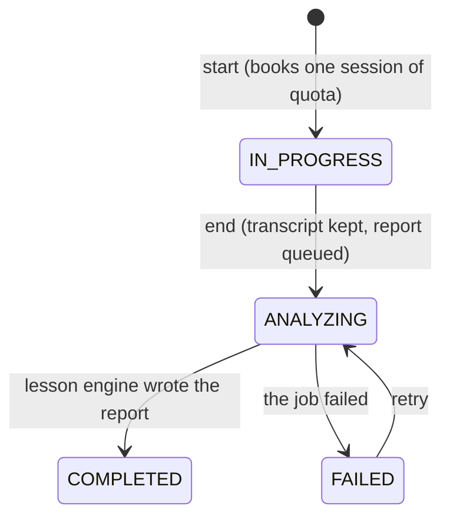

# Data model

The whole schema is one migration, [`db/migrations/0001_init.sql`](../../db/migrations/0001_init.sql).
Kysely types are in [`apps/api/src/db/types.ts`](../../apps/api/src/db/types.ts).

## Conventions

- Primary keys are ULIDs stored as `text` (sortable by creation time). Provider ids are
  slugs.
- Timestamps are `timestamptz(3)` and the API runs with `TZ=UTC`. Millisecond precision
  matches a JS `Date`, so keyset cursors round-trip exactly.
- Lists page with keyset cursors on `(created_at, id)`, never `OFFSET`.
- No tenant column: one deployment serves one organisation ([ADR 0002](adr/0002-single-tenant.md)).
- Provider API keys are never in the database ([ADR 0004](adr/0004-text-model-adapters.md)).
- The transcript is the only raw learner speech kept, on its practice session's row, and it
  goes with it ([ADR 0005](adr/0005-transcript-is-the-only-learner-content-kept.md)).
- Usage rows hold counts, seconds and model ids, never text ([ADR 0006](adr/0006-monthly-quotas-counts-only-usage.md)).
- Extensions: `citext` (case-insensitive email and username), `pg_trgm` (admin user search).

## Enums

| Enum | Values |
| --- | --- |
| `user_role` | `USER`, `ADMIN` |
| `user_status` | `PENDING_VERIFICATION`, `ACTIVE`, `SUSPENDED`, `BANNED`, `DEACTIVATED` |
| `auth_token_type` | `VERIFY_EMAIL`, `RESET_PASSWORD` |
| `provider_kind` | `OPENAI`, `ANTHROPIC`, `GEMINI`, `OPENAI_COMPATIBLE`, `STUB` |
| `model_kind` | `TEXT` (the lesson report), `REALTIME` (live voice) |
| `practice_status` | `IN_PROGRESS`, `ANALYZING`, `COMPLETED`, `FAILED` |
| `cefr_level` | `A1`, `A2`, `B1`, `B2`, `C1`, `C2` |
| `correction_type` | `grammar`, `pronunciation`, `word_choice`, `other` |
| `drill_type` | `fill_blank`, `translation`, `speak_this` |
| `live_status` | `OPEN`, `ENDED` (closed by the browser or the server on request), `EXPIRED` (closed by the sweeper) |

Learner goals are not an enum: `learner_profiles.goals` and `scenarios.goals` are `text[]`
constrained to `TRAVEL`, `INTERVIEW`, `BUSINESS`, `DAILY`, `ACADEMIC`.

## Practice session status

## Identity

### `quota_tiers`

Monthly allowances. `NULL` means unlimited.

| Column | Notes |
| --- | --- |
| `id`, `name` (unique, 1 to 60) | |
| `monthly_sessions`, `monthly_voice_minutes` | `>= 0` or `NULL` |
| `max_session_minutes` | 1 to 120, default 15: the longest one live session may run |
| `is_default` | exactly zero or one default (partial unique index `quota_tiers_one_default`) |

Seeded: `Default` with 30 practice sessions, 300 voice minutes, 15-minute sessions.

### `users`

| Column | Notes |
| --- | --- |
| `email` (citext, unique), `username` (citext, unique, 3 to 40 of letters, digits and dashes) | |
| `display_name` | 1 to 80, cleaned at write time (never an email or phone number) |
| `password_hash` | bcrypt |
| `role`, `status` | |
| `email_verified_at` | |
| `totp_secret` | AES-256-GCM ciphertext; `totp_enabled`; `totp_last_step` (a code works once) |
| `suspended_until` | |
| `token_version` | bumped by "sign out everywhere"; access tokens carry it |
| `quota_tier_id` | `NULL` = the default tier |
| `deletion_requested_at` | the purge job erases the account 14 days later unless they sign in |
| `last_seen_at`, `created_at`, `updated_at` | |

Indexes: a trigram index over name, username and email for admin search; a partial index
on non-`USER` roles.

### `sessions`

Refresh-token sessions. `token_hash` is the SHA-256 of the refresh token (unique);
`family_id` groups every rotation of one login so a replayed token can revoke the family.
Also `user_agent`, `ip`, `last_used_at`, `expires_at`, `revoked_at`, `replaced_by`.

### `auth_tokens`

Email verification and password reset tokens: `type`, `token_hash` (unique),
`expires_at`, `used_at`.

### `totp_recovery_codes`

Ten single-use codes per user, stored as an HMAC keyed from `TOTP_ENCRYPTION_KEY`.
Primary key `(user_id, code_hash)`.

### `user_preferences`

One row per user (a missing row means the defaults).

| Column | Default |
| --- | --- |
| `voice` | `alloy` (ignored when the model lacks it) |
| `default_realtime_model_id` | `NULL` (FK to `models`, set null on delete) |

The transcription language is not a preference: it comes from the learner's target language
(`domain/languages.ts`).

## Providers and models

### `providers`

| Column | Notes |
| --- | --- |
| `id` | the slug, 3 to 40 lowercase letters, digits and dashes; also the key name in `PROVIDER_KEYS` |
| `kind` | `provider_kind` |
| `display_name`, `base_url` (up to 300), `enabled` | |

### `models`

The one catalogue the runtime reads.

| Column | Notes |
| --- | --- |
| `provider_id` | cascade on provider delete |
| `kind` | `TEXT` or `REALTIME` |
| `model_ref` | the provider's model id |
| `display_name`, `description` | |
| `max_output_tokens` | default 8192 |
| `voices` | `text[]`, realtime only, the first is the default |
| `input_usd_per_mtok`, `output_usd_per_mtok`, `usd_per_minute` | optional, for the admin cost estimate only |
| `enabled`, `is_default`, `sort_order` | one default per kind (`models_one_default_per_kind`) |

Unique `(provider_id, model_ref, kind)`.

## Language practice

### `learner_profiles`

One row per learner (`user_id` is the primary key; cascade on user delete), created with
defaults on first read.

| Column | Notes |
| --- | --- |
| `native_language`, `target_language` | two-letter codes (`^[a-z]{2}$`); defaults `en` and `es`. The API checks them against `domain/languages.ts` |
| `level` | `cefr_level`, default `A1` |
| `goals` | `text[]` of the five goals, default `{DAILY}` |
| `daily_minutes_target` | 1 to 240, default 10 |
| `onboarding_complete` | starting a session needs it |

### `scenarios`

Role-play situations. `prompt_template` (1 to 4,000) is staff-only: it goes into the tutor's
instructions on the server and is never returned to a learner.

| Column | Notes |
| --- | --- |
| `title` (1 to 80), `description` (up to 300) | what the learner sees |
| `level_min`, `level_max` | the levels it suits |
| `goals` | `text[]`; empty means it suits every goal |
| `sort_order`, `is_active` | order on the picker (lower first), and whether learners see it |

Index `(sort_order, created_at)`.

### `practice_sessions`

One conversation with the tutor.

| Column | Notes |
| --- | --- |
| `user_id` | owner; cascade on user delete |
| `scenario_id` | `ON DELETE SET NULL`; `NULL` for free conversation or after the scenario was deleted |
| `title` | the scenario's title when it started ("Free conversation" otherwise), kept if the scenario goes |
| `status` | `practice_status` |
| `target_language`, `native_language`, `level` | copied from the profile at the start, so a later profile change does not rewrite history |
| `transcript` | `jsonb` `[{ role: "tutor" \| "learner", text }]`, cleaned by the server ([LLD.md](LLD.md#39-ending-the-practice-session-and-the-report)) |
| `summary` | up to 2,000, written by the lesson engine |
| `vocab_suggestions` | `jsonb` `[{ phrase, meaningNative, examples }]`, at most 10 |
| `scores` | `jsonb` `{ fluency, accuracy, vocabRange, confidence }`, each 1 to 10, written only by the analyze job |
| `overall_score` | `numeric(3,1)`, the mean of the four scores |
| `engine` | `llm` or `offline`: which lesson engine wrote the report; `NULL` until it is `COMPLETED` ([lesson-engine.md](lesson-engine.md)) |
| `error` | up to 300, a fixed safe message when `FAILED` |
| `text_model_id`, `realtime_model_id` | set null on model delete |
| `started_at`, `ended_at`, `duration_sec` | the duration is the sum of the live sessions' server-measured seconds |

Indexes: `(user_id, created_at DESC, id DESC)` for the owner's list, `(created_at DESC, id DESC)`
for admin, and `(user_id, ended_at)` where ended, which the dashboard reads.

### `live_sessions`

One realtime connection. A practice session may open several (a reconnect).

| Column | Notes |
| --- | --- |
| `practice_session_id` | cascade on delete |
| `user_id`, `model_id`, `provider_kind` | |
| `status` | `OPEN`, `ENDED`, `EXPIRED` |
| `credential_hash` | SHA-256 of the minted credential; the relay matches on it. Never the value |
| `provider_call_id` | OpenAI call id from the relayed SDP answer, for hang-up |
| `max_seconds`, `seconds` | the cap, and the server-measured time booked at close |
| `created_at`, `expires_at`, `ended_at` | `expires_at` = connect window + `max_seconds` + grace |

Indexes: `live_sessions_one_open` (unique on `user_id` where `status = 'OPEN'`: one open
session per user), by practice session, by user and month, and by `credential_hash` where open.

### `corrections`

What the lesson engine found worth fixing, in order: `practice_session_id` (cascade),
`position`, `type`, `original` and `corrected` (up to 500 each) and `explanation` (up to 800,
in the learner's native language when the engine can). Replaced, never appended, each time
the report is written.

### `drills`

The five micro-drills that close a lesson: `practice_session_id` (cascade), `position`,
`type`, `question`, `answer` (up to 500 each) and `hints` (`jsonb` array of strings). There
are none for a session where the learner said nothing.

### `vocab_items`

The learner's deck. Saving the same phrase twice is a no-op: the unique index
`vocab_items_phrase_key` is on `(user_id, target_language, lower(phrase))`.

| Column | Notes |
| --- | --- |
| `phrase` (1 to 200), `meaning_native` (1 to 300), `examples` | the card |
| `source_session_id` | `ON DELETE SET NULL`: deleting a session keeps the cards |
| `ease` | starts at 2.5, never below 1.3 |
| `interval_days`, `repetitions` | the SM-2 state; an interval of 21 days or more is "mastered" |
| `next_review_at` | when it is due; index `(user_id, next_review_at)` |

### `review_log`

One row per graded review (`user_id`, `vocab_id` set null on card delete, `grade`,
`reviewed_at`), so "done today" survives a deck that reschedules everything.

## Quotas and usage

### `user_quota_overrides`

One user's numbers on top of their tier: `monthly_sessions`, `monthly_voice_minutes`
(`NULL` falls back to the tier), `note`, `updated_by`.

### `usage_daily`

Daily totals per user and model in the UTC day, primary key `(user_id, day, model_id)`.
Counts only ([ADR 0006](adr/0006-monthly-quotas-counts-only-usage.md)).

| Column | Meaning |
| --- | --- |
| `calls`, `input_tokens`, `output_tokens` | text model usage (the lesson engine's calls, the admin test) |
| `sessions` | practice sessions started. Kept here, not counted from `practice_sessions`, so deleting a session does not give quota back |
| `voice_seconds` | booked when a live session closes |

## Operations

### `settings`

Key and `jsonb` value. The `app` row is the deployment settings document
([configuration](../guides/configuration.md#deployment-settings-adminsettings)). The
`starter_scenarios` row marks that the twelve starter scenarios were inserted.

### `audit_log`

Who did what: `actor_id` (set null on user delete), `action`, `entity_type`, `entity_id`,
`ip`, `data` (`jsonb`), `created_at`. Indexed by recency, by entity and by actor.
